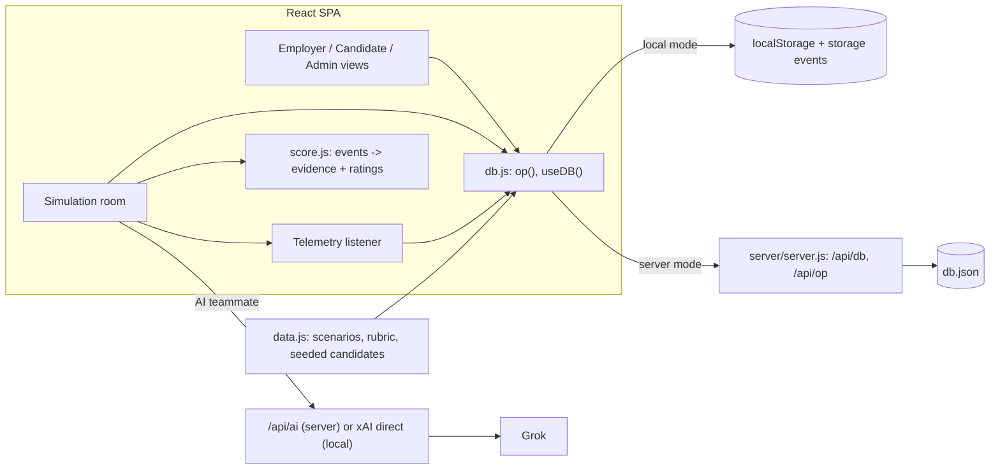
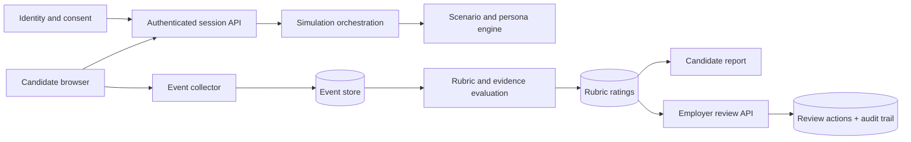

# Unseen architecture

Demo. Fictional people and employers. Scores are illustrative and unvalidated.

## Demo architecture

- **One operation format.** `shared.js` defines `put`, `patch`, `append`, `del`, `settings` and `replace`. The browser and the server apply the same operations, so local and server modes behave the same.
- **Local mode.** State is in `localStorage`. Browser tabs sync through `storage` events, so tabs act as separate users.
- **Server mode.** The app detects `/api/db` and switches. The server persists to `server/db.json` and the browser polls every 2 seconds. Concurrent writes use patch and append, not whole-document overwrites. This is suitable for a demo, not for production.
- **Scenarios and settings are data.** Everything in the admin panel edits the same store the app reads.
- **Participants.** Participant B can be a scripted teammate, an AI teammate, a second real person who joins by code, or absent. Participant C is an optional AI colleague. Each AI turn sends the scenario brief, that persona’s private fact and a short nudge to the model. On any AI failure the room falls back to scripted lines.
- **Scoring (`score.js`).** Candidate records are generated from the session log when a participant finishes. Rules use recorded actions only: sharing information, asking a clarifying question, noting confirmed versus unconfirmed facts, documenting, building on a teammate, the quality tier of each scenario decision, and whether the second decision improved after the new information. Response speed, typing speed, message volume, grammar and style are never used. Every rating cites evidence items taken from the real session, or is “Not observed”. Reflection is optional and not scored.
- **Telemetry.** `visibilitychange`, window focus and blur (secondary), online and offline, resume on reload or re-entry, pause, submit and complete. Each event has a participant, timestamp, session id and neutral text, and is shown to both candidate and employer. Events never change a rating. Idle detection is not implemented.
- **Admin gate.** A client-side passcode only. It is not security.

## Production design (not built)

Also required: scenario and rubric versioning; role-based access between candidate and employer; an audit trail for score changes and reviewer actions; retention and deletion policy; encryption in transit and at rest; real authentication and a real database; human review and candidate appeal; bias and validity monitoring and formal validation before any real hiring use; no real patient or customer data; raw events, derived ratings and human decisions stored separately; AI keys kept server-side with prompt and output logging.

## Data model

| Entity | Purpose and key relations |
|---|---|
| User | A person using the candidate portal. Has many sessions and candidate records. |
| Scenario | Brief, three role facts, scripted pressure points, options with quality tiers, optional teammate-mode override. |
| Session | One run: scenario, mode (B and C), shared chat log, per-participant notes, stage, decisions and events. |
| Candidate | Generated record per participant: ratings, evidence, status. Linked to a User and a Session. |
| Evidence item | A real message, action, decision or note from the session that backs a rating. |
| Settings | Admin-controlled defaults: AI on or off, model, default teammate, reflection. |